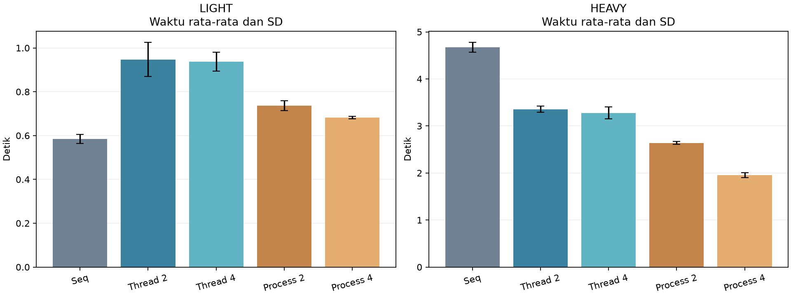
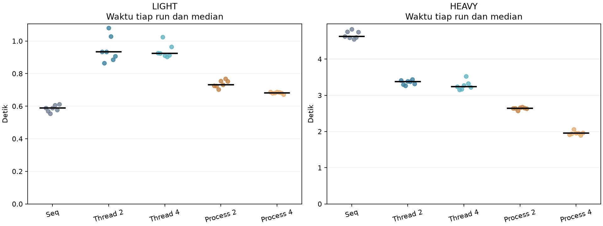
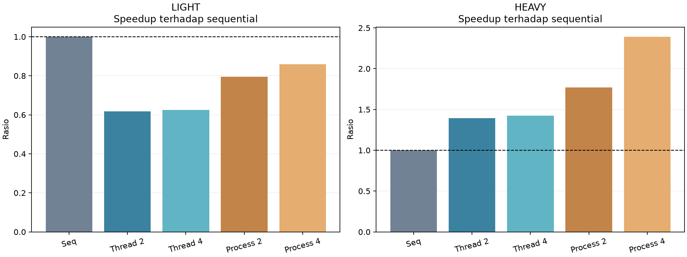
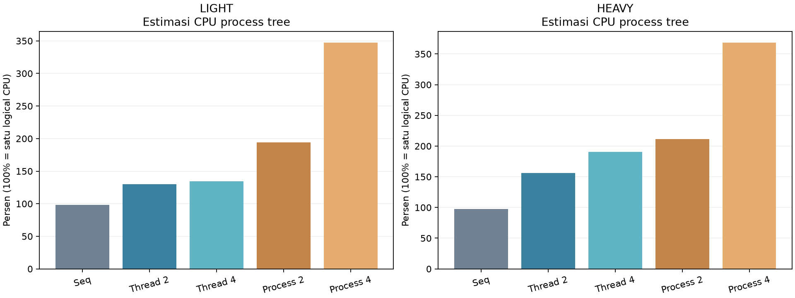
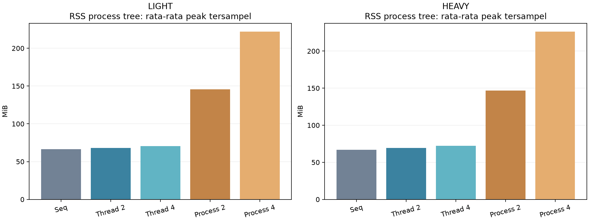

# Analisis Performa Sequential Multithreading dan Multiprocessing pada Pemrosesan Gambar

## Ringkasan

Saya membandingkan lima konfigurasi pemrosesan gambar pada komputer Windows lokal: sequential, multithreading dengan 2 dan 4 worker, serta multiprocessing dengan 2 dan 4 worker. Saya menggunakan 10,000 gambar dari CIFAR-10, dua workload, dan 7 pengulangan per-kondisi, sehingga ada 70 pengukuran. LIGHT memiliki rata-rata tercepat pada sequential (0.585 detik, speedup 1.00); HEAVY memiliki rata-rata tercepat pada multiprocessing 4 worker (1.954 detik, speedup 2.39). Hasil tersebut saya baca bersama penggunaan resource dan variasi run, sehingga pilihan metode tidak hanya ditentukan oleh jumlah worker.

## Latar belakang dan tujuan

Dalam pemrosesan gambar, pekerjaan dapat dilakukan satu per satu atau dibagi ke beberapa worker. Pembagian pekerjaan berpotensi mempercepat program, tetapi juga menambah biaya koordinasi dan penggunaan resource. Saya melakukan eksperimen ini untuk melihat hubungan tersebut dengan pengelolaan thread, process, CPU, dan memori pada Operating System.

Pertanyaan yang saya gunakan adalah:

1. Konfigurasi mana yang memiliki rata-rata waktu terendah pada LIGHT dan HEAVY?
2. Apakah penambahan worker dari 2 menjadi 4 mempercepat pekerjaan?
3. Bagaimana penggunaan CPU dan RAM berubah ketika metode pemrosesan berubah?
4. Seberapa konsisten hasilnya antar-pengulangan?

## Dataset dan lingkungan pengujian

Saya memakai batch pertama CIFAR-10 yang berisi 10.000 gambar RGB 32 × 32 piksel. Label kelas tidak digunakan dalam transformasi. Dataset resmi sudah diverifikasi dengan checksum, dan hash batch yang dipakai dicatat pada konfigurasi setiap eksekusi. Resize menggunakan ukuran kerja 64 × 64; ukuran kerja ini memperbesar jumlah piksel yang diproses, bukan menambah detail asli gambar.

| Komponen | Lingkungan yang tercatat |
|---|---|
| Waktu pengujian | 2026-10-05T13:58:45.282190+07:00 |
| OS dari platform Python | Windows-10-10.0.26200-SP0 |
| Python | 3.11.9 |
| CPU | Intel(R) Core(TM) Ultra 9 185H |
| Core fisik dan logical CPU | 16 dan 22 |
| RAM terpasang | 31.43 GiB |
| Tempat eksekusi | Local/on-premise |

String OS di atas adalah keluaran fungsi platform Python, bukan identifikasi edisi Windows melalui pemeriksaan terpisah. Versi library tercatat pada file environment: NumPy 2.4.6, Pillow 12.3.0, psutil 7.2.2, pandas 3.0.6, dan Matplotlib 3.11.2.

## Metode eksperimen

| Workload | Transformasi dengan parameter tetap |
|---|---|
| LIGHT | Resize 64 × 64 BILINEAR lalu grayscale |
| HEAVY | Resize 64 × 64 BILINEAR, rotate 15°, Gaussian blur radius 2, sharpen, color factor 1,2, lalu edge detection |

Sequential memakai satu worker pengolah. Thread pool memakai 2 atau 4 thread dalam satu proses. Process pool memakai 2 atau 4 proses dengan start method spawn. Pada kedua jenis pool, satu task berisi 100 gambar, dan jumlah task yang belum dikonsumsi dibatasi 2 × worker. Output dikonsumsi sesuai urutan input dan dimasukkan ke SHA-256; saya tidak menyimpan seluruh gambar hasil sekaligus.

Setiap kondisi dijalankan di proses benchmark baru. Parent memproses 50 gambar sebagai warm-up sebelum timer. Worker process tetap baru dan belum di-warm-up. Timer mencakup transformasi, konversi byte, hashing, monitoring, startup/shutdown pool, penjadwalan task, dan komunikasi data. Startup interpreter benchmark, pemuatan dataset, warm-up parent, serta penulisan laporan berada di luar timer.

Urutan sepuluh kondisi diputar tiga posisi setiap pengulangan. Saya tidak menghapus outlier untuk memperbaiki hasil. Angka laporan akhir berasal dari rangkaian dengan 7 pengulangan ini; hasil tiga pengulangan sebelumnya dipertahankan sebagai tahap awal dan tidak digabungkan ke rata-rata akhir.

| Metrik | Definisi |
|---|---|
| Execution time | Wall time dalam detik dari perf_counter |
| Throughput | Jumlah gambar dibagi waktu setiap run; ringkasan memakai rata-rata nilai per-run |
| Speedup | Rata-rata waktu sequential dibagi rata-rata waktu metode pada workload yang sama |
| Efficiency | Speedup dibagi worker × 100%; bukan persentase CPU |
| Variasi waktu | Sample SD, CV = SD/rata-rata × 100%, median, minimum, dan maksimum |
| CPU sampled tree | CPU delta parent ditambah CPU kumulatif terakhir child yang sempat diamati, dibagi wall time × 100% |
| RSS sampled tree | Maksimum jumlah RSS parent dan descendant processes pada snapshot bersamaan |

Monitor mengambil snapshot sekitar setiap 50 ms. CPU tree merupakan estimasi karena CPU teardown child setelah snapshot terakhir dapat terlewat. RAM tree bisa menghitung halaman shared lebih dari sekali dan melewatkan puncak singkat. Overhead monitor juga masuk ke pengukuran. Batasan ini berlaku pada seluruh konfigurasi dalam rangkaian akhir.

## Grafik hasil











Titik pada grafik distribusi menunjukkan seluruh pengulangan; garis hitam menunjukkan median. Error bar pada grafik rata-rata adalah sample SD. Grafik tidak menyatakan confidence interval atau hasil uji signifikansi.

## Hasil pengukuran

| Workload | Metode | Worker | Waktu rata-rata (s) | SD (s) | Gambar/s | Speedup | Estimasi CPU tree (%) | RSS tree peak rata-rata (MiB) |
|---|---|---:|---:|---:|---:|---:|---:|---:|
| HEAVY | sequential | 1 | 4.672 | 0.106 | 2141.5 | 1.00 | 97.2 | 66.75 |
| HEAVY | threading | 2 | 3.357 | 0.065 | 2979.7 | 1.39 | 156.4 | 69.40 |
| HEAVY | threading | 4 | 3.275 | 0.126 | 3057.2 | 1.43 | 190.6 | 72.37 |
| HEAVY | multiprocessing | 2 | 2.639 | 0.033 | 3790.1 | 1.77 | 211.4 | 146.76 |
| HEAVY | multiprocessing | 4 | 1.954 | 0.052 | 5121.1 | 2.39 | 368.5 | 226.26 |
| LIGHT | sequential | 1 | 0.585 | 0.021 | 17101.8 | 1.00 | 98.4 | 66.60 |
| LIGHT | threading | 2 | 0.947 | 0.078 | 10613.9 | 0.62 | 130.1 | 68.28 |
| LIGHT | threading | 4 | 0.938 | 0.043 | 10680.2 | 0.62 | 134.2 | 70.34 |
| LIGHT | multiprocessing | 2 | 0.737 | 0.022 | 13580.5 | 0.79 | 194.4 | 145.52 |
| LIGHT | multiprocessing | 4 | 0.682 | 0.005 | 14668.4 | 0.86 | 347.3 | 222.00 |

## Analisis per-workload

### LIGHT

Rata-rata tercepat adalah sequential, dengan waktu 0.585 detik dan speedup 1.00. Process 2 membutuhkan 0.737 detik (speedup 0.79), sedangkan process 4 0.682 detik (speedup 0.86). Nilai speedup di bawah 1 menunjukkan lebih lambat dari sequential.

Dari process 2 ke process 4, perubahan waktu rata-rata adalah -7.5%. Angka positif berarti bertambah lambat, angka negatif berarti lebih cepat. Saya tidak menganggap jumlah worker berbanding lurus dengan peningkatan kecepatan.

RSS tree peak tersampel rata-rata meningkat dari 66.60 MiB pada sequential menjadi 145.52 MiB untuk process 2 dan 222.00 MiB untuk process 4. Nilai ini adalah jumlah RSS proses pada snapshot bersamaan, bukan ukuran memori unik.

Konfigurasi dengan waktu terendah pada setiap putaran adalah sequential_1: 7 dari 7 putaran. Setiap putaran berisi seluruh konfigurasi yang dijalankan berurutan, bukan pada saat bersamaan. Hitungan ini menunjukkan konsistensi deskriptif, bukan uji signifikansi.

| Konfigurasi | Median (s) | Minimum (s) | Maksimum (s) | CV waktu (%) |
|---|---:|---:|---:|---:|
| sequential_1 | 0.588 | 0.554 | 0.613 | 3.52 |
| threading_2 | 0.933 | 0.864 | 1.079 | 8.24 |
| threading_4 | 0.925 | 0.903 | 1.025 | 4.60 |
| multiprocessing_2 | 0.731 | 0.703 | 0.768 | 3.04 |
| multiprocessing_4 | 0.682 | 0.672 | 0.687 | 0.76 |

Median saya gunakan sebagai pembanding terhadap rata-rata ketika terdapat run yang jauh lebih lambat. Semua run tetap disertakan dalam CSV dan rata-rata.

### HEAVY

Rata-rata tercepat adalah multiprocessing 4 worker, dengan waktu 1.954 detik dan speedup 2.39. Process 2 membutuhkan 2.639 detik (speedup 1.77), sedangkan process 4 1.954 detik (speedup 2.39). Nilai speedup di bawah 1 menunjukkan lebih lambat dari sequential.

Dari process 2 ke process 4, perubahan waktu rata-rata adalah -26.0%. Angka positif berarti bertambah lambat, angka negatif berarti lebih cepat. Saya tidak menganggap jumlah worker berbanding lurus dengan peningkatan kecepatan.

RSS tree peak tersampel rata-rata meningkat dari 66.75 MiB pada sequential menjadi 146.76 MiB untuk process 2 dan 226.26 MiB untuk process 4. Nilai ini adalah jumlah RSS proses pada snapshot bersamaan, bukan ukuran memori unik.

Konfigurasi dengan waktu terendah pada setiap putaran adalah multiprocessing_4: 7 dari 7 putaran. Setiap putaran berisi seluruh konfigurasi yang dijalankan berurutan, bukan pada saat bersamaan. Hitungan ini menunjukkan konsistensi deskriptif, bukan uji signifikansi.

| Konfigurasi | Median (s) | Minimum (s) | Maksimum (s) | CV waktu (%) |
|---|---:|---:|---:|---:|
| sequential_1 | 4.626 | 4.545 | 4.830 | 2.26 |
| threading_2 | 3.379 | 3.265 | 3.438 | 1.93 |
| threading_4 | 3.244 | 3.156 | 3.528 | 3.86 |
| multiprocessing_2 | 2.644 | 2.572 | 2.674 | 1.24 |
| multiprocessing_4 | 1.952 | 1.896 | 2.058 | 2.67 |

Median saya gunakan sebagai pembanding terhadap rata-rata ketika terdapat run yang jauh lebih lambat. Semua run tetap disertakan dalam CSV dan rata-rata.

## Hubungan hasil dengan Operating System

Thread membaca array input dalam satu proses. Process memiliki interpreter serta ruang alamat sendiri. Implementasi ini mengirim chunk array melalui mekanisme serialization/IPC dan menerima byte output kembali; tidak memakai shared memory. Akibatnya, multiprocessing mengubah biaya koordinasi dan memori, selain jumlah worker.

Worker Windows dibuat dengan spawn. Startup worker, import library di worker, pengiriman data, pemrosesan, pengumpulan output, dan shutdown pool berada di dalam timer. Warm-up 50 gambar hanya dilakukan pada proses utama sebelum timer; worker baru tidak mendapat warm-up sebelumnya. Ini merupakan skenario pool baru per-run, bukan skenario pool persistent. Overhead tersebut merupakan kemungkinan penjelasan hasil, tetapi saya belum mengukurnya sebagai komponen terpisah.

Setiap worker process mempunyai GIL sendiri. Namun menghindari GIL antar-worker tidak menjamin program lebih cepat karena IPC, serialization, serta bagian serial seperti hashing tetap ada. Pada threading, library native dapat melepas GIL. Saya tidak menganggap perbedaan waktu membuktikan GIL sebagai satu-satunya penyebab.

Task pool berisi 100 gambar, dengan maksimum 2 x worker task belum dikonsumsi. Task diambil sesuai urutan pengiriman agar hash sama. Menunggu output awal dapat menghambat pengumpulan output lain. Sequential memproses satu gambar per-iterasi tanpa task pool. Kesimpulan berlaku untuk kebijakan pembagian pekerjaan ini.

## Cara membaca CPU dan RAM

CPU tree mencakup proses benchmark dan turunannya, dengan 100% setara satu logical CPU. Komputer ini memiliki 22 logical CPU. Persentase dapat melebihi 100%, tetapi bukan total penggunaan seluruh CPU komputer.

CPU proses utama dihitung dari perubahan CPU time selama timer. CPU worker dihitung dari nilai kumulatif terakhir yang sempat diamati; snapshot diambil sebelum shutdown agar worker yang masih hidup tercatat. Sebagian CPU teardown setelah snapshot terakhir dapat tidak tercatat. Karena itu kolom CPU tree adalah estimasi tersampel, bukan pengukuran CPU total yang sepenuhnya presisi.

RAM diambil tiap sekitar 50 ms dengan monitor thread yang sama untuk semua metode, serta snapshot di awal, sebelum shutdown pool, dan di akhir. Yang dilaporkan adalah maksimum jumlah RSS pada snapshot, bukan penjumlahan peak tiap proses pada waktu berbeda. Halaman memori shared bisa dihitung lebih dari sekali; puncak singkat dan perubahan proses saat snapshot bisa terlewat. Angka ini bukan unique memory/PSS atau seluruh RAM komputer. Overhead monitor ikut memengaruhi semua kondisi.

## Validasi dan keterbatasan

Semua konfigurasi pada workload yang sama menghasilkan hash SHA-256 yang sama. Jumlah output dan rumus throughput juga diperiksa. Hash membuktikan konsistensi byte output pada input ini, bukan penilaian kualitas visual.

7 pengulangan memberi gambaran variasi yang lebih lengkap, tetapi bukan uji signifikansi. Input ringan yang selesai di bawah satu detik sensitif terhadap gangguan kecil. Urutan konfigurasi diputar, tetapi temperatur, background task, serta pemilihan core tidak dikendalikan atau dicatat. Saya belum membandingkan input lebih besar, chunk lain, shared memory, pool persistent, atau pipeline penyimpanan file.

Metode monitoring pada tahap ini berbeda dari notebook 01/02. Karena itu, perbandingan akhir hanya memakai CSV rangkaian ini; angka CPU/RAM lama tidak dicampur dengan kolom process tree baru. Error bar adalah sample SD, bukan confidence interval.

## Kesimpulan

Berdasarkan rata-rata yang terukur, konfigurasi tercepat adalah LIGHT: sequential; HEAVY: multiprocessing 4 worker. Saya membaca pilihan tersebut bersama biaya CPU/RAM dan variasi run. Hasil ini menunjukkan pilihan metode perlu disesuaikan dengan workload serta biaya koordinasi, bukan sekadar memilih jumlah worker terbanyak. Kesimpulan terbatas pada kondisi lokal ini.

## Referensi

- [Python 3.11 ProcessPoolExecutor](https://docs.python.org/3.11/library/concurrent.futures.html#concurrent.futures.ProcessPoolExecutor)
- [Python 3.11 multiprocessing dan start methods](https://docs.python.org/3.11/library/multiprocessing.html#contexts-and-start-methods)
- [psutil Process and System Utilities](https://psutil.readthedocs.io/)
- [CIFAR-10 dan laporan Alex Krizhevsky 2009](https://www.cs.toronto.edu/~kriz/cifar.html)


## Bukti hasil dan cara mengulang

Data pendukung tersedia di [hasil mentah](../../results/comparison/20261005_135845_282190/raw_results.csv), [ringkasan](../../results/comparison/20261005_135845_282190/summary.csv), [sampel resource](../../results/comparison/20261005_135845_282190/resource_samples.csv), [konfigurasi](../../results/comparison/20261005_135845_282190/config.json), dan [environment](../../results/comparison/20261005_135845_282190/environment.json). Snapshot source serta hash input disimpan bersama hasil untuk membantu memeriksa pekerjaan yang dijalankan.

Notebook `04_final_analysis.ipynb` memuat penjelasan dan output eksekusi yang sama. Untuk mengulang melalui terminal dari folder project:

```powershell
.\.venv\Scripts\python.exe main.py --experiment comparison --images 10000 --repetitions 7 --warmup 50
```

Setiap eksekusi membuat folder hasil baru. Pengulangan tambahan, input lebih besar, atau skenario pool persistent dapat menjadi pengembangan berikutnya; hasilnya harus dilaporkan terpisah jika mengubah skenario.
